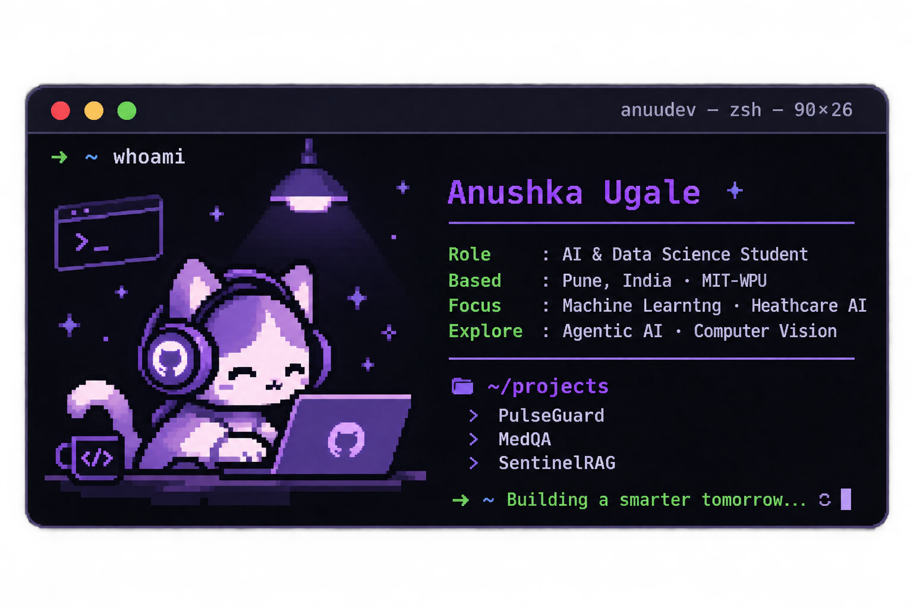

 

# Anushka Ugale

### AI & Data Science Student | Machine Learning | Healthcare AI

Pune, India · MIT World Peace University

[GitHub](https://github.com/Anushka0827) · [LinkedIn](https://www.linkedin.com/in/anushka-ugale/)

---

## `$ whoami`

Hi, I'm Anushka, a second-year B.Tech student in Artificial Intelligence and Data Science.

I enjoy learning by building practical projects and exploring how AI can solve real-world problems. My work and interests span healthcare AI, machine learning, computer vision, and intelligent applications.

I'm particularly interested in understanding the complete AI development process — from data preprocessing and model development to evaluation, optimization, and deployment.

Currently, I'm strengthening my technical foundations while exploring Deep Learning, Agentic AI, and MLOps.

## `$ current-focus`

- Exploring Machine Learning and Deep Learning.
- Building healthcare-focused AI applications.
- Learning Computer Vision techniques.
- Exploring Agentic AI and intelligent workflows.
- Understanding model deployment and MLOps.

## `$ tech-stack`

**Programming Languages**

Python · C · C++ · Java · SQL

**Machine Learning & AI**

Scikit-learn · TensorFlow · Keras · XGBoost

**Data Science**

NumPy · Pandas · Matplotlib · Seaborn

**Computer Vision**

OpenCV · YOLO

**Web Development & Deployment**

HTML · CSS · Flask · Streamlit · Docker

**Tools & Platforms**

Git · GitHub · Jupyter Notebook · Google Colab · VS Code

*I have worked with or explored these technologies and am continuously developing deeper practical proficiency.*

---

## `$ featured-projects`

### 01. PulseGuard — Contact-Free Cardiac Monitoring

[View Repository](https://github.com/Anushka0827/Contactless-Heart-Rate-Detection)

A contact-free cardiac monitoring project that uses facial video and remote photoplethysmography (rPPG) to estimate heart rate.

**Key areas explored:**
- Facial video-based pulse extraction.
- Multi-region and multi-algorithm signal analysis.
- Signal Quality Index (SQI).
- BPM estimation and HRV analysis.
- AI applications in healthcare.

### 02. MedQA — Healthcare ML & MLOps

[View Repository](https://github.com/Anushka0827/mlops-healthcare)

A healthcare-focused machine learning project exploring structured ML workflows and deployment practices.

**Key areas explored:**
- Machine learning pipelines.
- Model experimentation.
- Workflow structuring.
- Docker and cloud deployment concepts.

### 03. Pothole Detection

[View Repository](https://github.com/Anushka0827/Potholes_Detection)

A computer vision project focused on identifying potholes through image-based detection techniques, with applications in road safety and intelligent transportation.

### 04. Iris Flower Prediction

[View Repository](https://github.com/Anushka0827/Iris-flower-prediction)

A machine learning classification application that predicts iris flower species using flower measurements, integrated with a Flask-based interface.

### 05. Marketing Attribution Framework

[View Repository](https://github.com/Anushka0827/Marketing-attribution-framework-for-Grito_Labs)

An analytics-focused project exploring marketing attribution and performance measurement.

### 06. Machine Learning Experiments

[View Repository](https://github.com/Anushka0827/Machine-Learning)

A collection of practical experiments and notebooks covering data preprocessing, feature engineering, model training, and evaluation.

---

## `$ research`

**IEEE Xplore Research Publication**

*Impact of SMOTE Balancing and SHAP-Based Feature Importance on EEG-Based Anxiety Detection Using PSD Features.*

Research exploring EEG-based anxiety detection through signal processing, machine learning, class balancing, and explainable AI techniques.

[View IEEE Publication](https://ieeexplore.ieee.org/document/11705853)

---

## `$ achievements`

- **1st Place** — CoDeC MIT-WPU Trifecta 2026, Machine Learning Track.
- **National AI Hackathon Finalist** — Selected from 400+ teams and 1,600+ participants.
- **IEEE Xplore Research Author** — Published research on EEG-based anxiety detection.
- **Top 20** — HackMIT 2025 Ideathon.
- **Top 300 Teams in India** — OpenAI Codex Hackathon.
- **Grandmaster** — Abacus.

---

## `$ github-stats`

 

---

## `$ connect`

- **GitHub:** https://github.com/Anushka0827
- **LinkedIn:** https://www.linkedin.com/in/anushka-ugale/

### Building, learning, experimenting.

*Turning ideas into practical solutions, one project at a time.*

